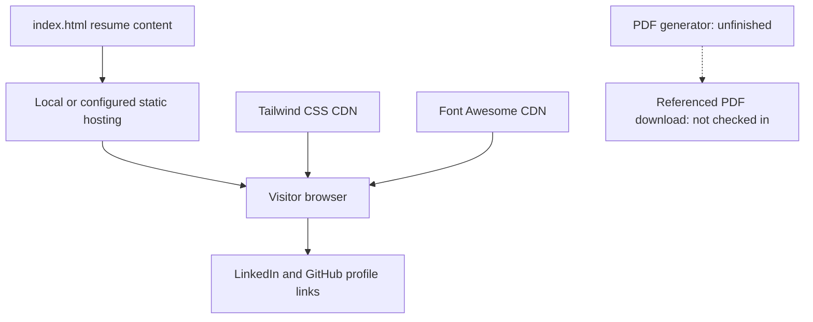

# Maria Tzanidaki: Resume Website

A static HTML resume presenting Maria's cloud-engineering experience, skills, projects and certifications, with a responsive layout and external CSS/icon assets.

**Status:** The default branch serves HTML directly. PDF generation is unfinished: the generator is a placeholder and the linked PDF/profile image are not checked in. A Markdown-based build is proposed separately in PR #8.

## Architecture

## Start here

Run `python3 -m http.server 8000` and open the local site. Edit [index.html](index.html) for the current implementation. Review [the proposed Markdown/PDF workflow](https://github.com/mtzanida/resume/pull/8) separately; it is not part of this branch. [docs/SETUP.md](docs/SETUP.md) retains the existing setup notes.

[Previous README and detailed reference](https://github.com/mtzanida/resume/blob/7527f470426f405721cf05ea969217ff0a14b848/README.md) are retained in Git history. They may describe older assumptions or unmerged plans; the scope above reflects this branch.
