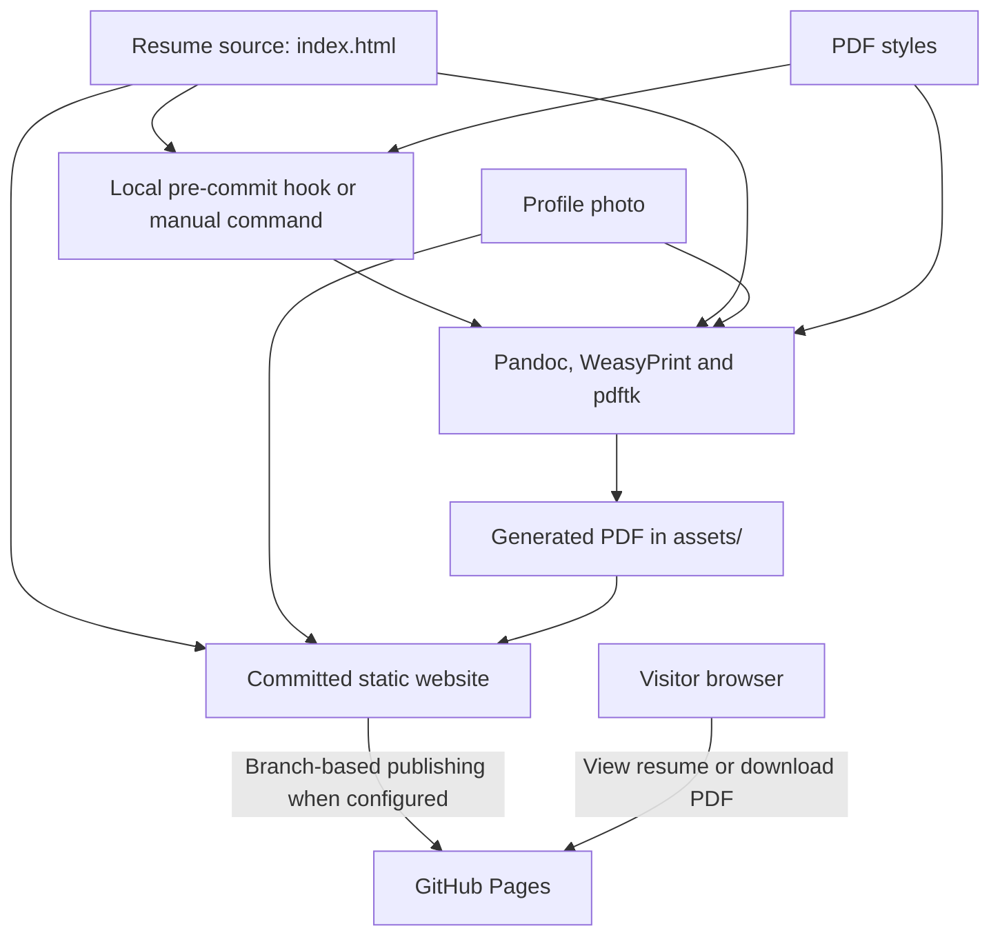

# Maria Tzanidaki — Resume Website

A personal resume website presenting Maria Tzanidaki's cloud engineering
background, technical skills, work experience, projects, education and
certifications. Visitors can browse the resume online and download a PDF copy.

## Features

- Responsive, dark-themed layout built with HTML, Tailwind CSS and client-side JavaScript.
- Professional profile photo and contact links.
- Downloadable PDF resume stored alongside the website.
- Local PDF generation from the HTML source, with dedicated print styles.
- An optional pre-commit hook that regenerates the PDF when matching source files change.

## Project structure

| Location | Purpose |
| --- | --- |
| [index.html](index.html) | Website entry point and resume content |
| [images/](images/) | Profile photo and image assets |
| [assets/](assets/) | Downloadable PDF resume |
| [styling/](styling/) | PDF-specific stylesheets |
| [scripts/](scripts/) | Dependency installation and PDF generation |
| [initial-draft/](initial-draft/) | Earlier TSX draft, separate from the static website |
| [docs/SETUP.md](docs/SETUP.md) | Setup, customization, PDF generation, publishing and troubleshooting |

## Architecture

PDF generation runs on the contributor's machine after dependencies and hooks are
installed. The repository contains no GitHub Actions workflow for generating PDFs.
GitHub Pages can serve the committed static files without an application server
or database; its live configuration is not verified by this diagram.

## Reuse

Free to use as a template for your own resume. See the
[setup and customization guide](docs/SETUP.md) for instructions.
