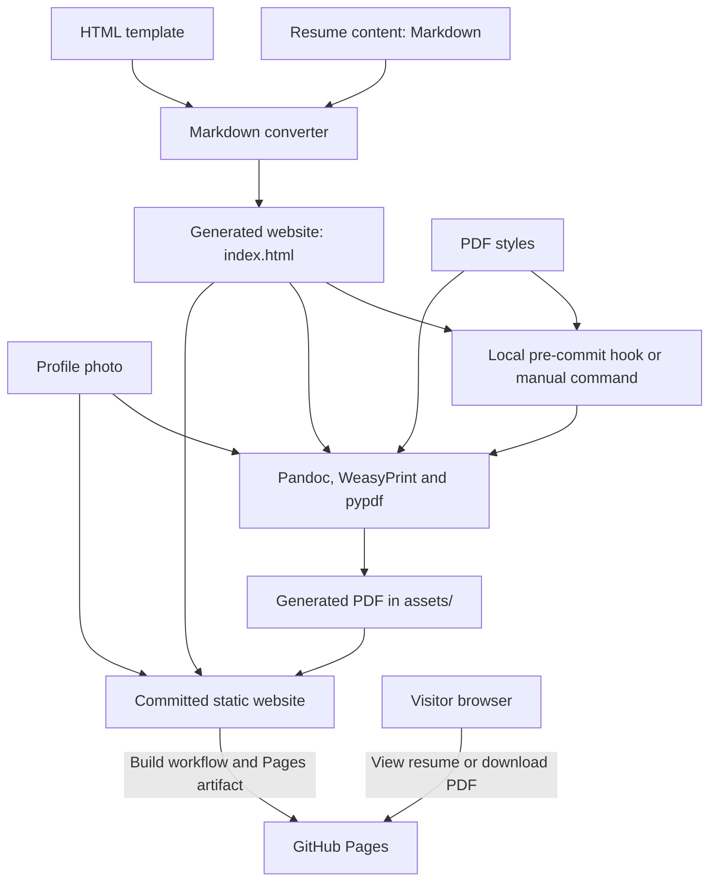

# Maria Tzanidaki — Resume Website

A personal resume website presenting Maria Tzanidaki's cloud engineering
background, technical skills, work experience, projects, education and
certifications. Visitors can browse the resume online and download a PDF copy.

## Features

- Responsive, dark-themed layout built with HTML, Tailwind CSS and client-side JavaScript.
- Professional profile photo and contact links.
- Downloadable PDF resume stored alongside the website.
- Markdown content converted into the existing HTML layout.
- Local PDF generation from the generated HTML, with dedicated print styles.
- An optional pre-commit hook that regenerates the PDF when matching source files change.

## Project structure

| Location | Purpose |
| --- | --- |
| [content/resume.md](content/resume.md) | Editable resume text in Markdown |
| [templates/index.html](templates/index.html) | Existing website layout and styling |
| [index.html](index.html) | Generated website entry point |
| [images/](images/) | Profile photo and image assets |
| [assets/](assets/) | Downloadable PDF resume |
| [styling/](styling/) | PDF-specific stylesheets |
| [scripts/](scripts/) | Dependency installation and PDF generation |
| [initial-draft/](initial-draft/) | Earlier TSX draft, separate from the static website |
| [docs/SETUP.md](docs/SETUP.md) | Setup, customization, PDF generation, publishing and troubleshooting |

## Architecture

PDF generation runs locally with the installed tools and in GitHub Actions. The Build resume workflow regenerates HTML/PDF, commits the outputs on main and
deploys a dedicated GitHub Pages artifact.
GitHub Pages serves the generated static files without an application server
or database; its live configuration is not verified by this diagram.

## Reuse

Free to use as a template for your own resume. See the
[setup and customization guide](docs/SETUP.md) for instructions.
